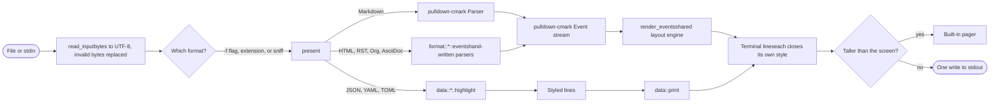
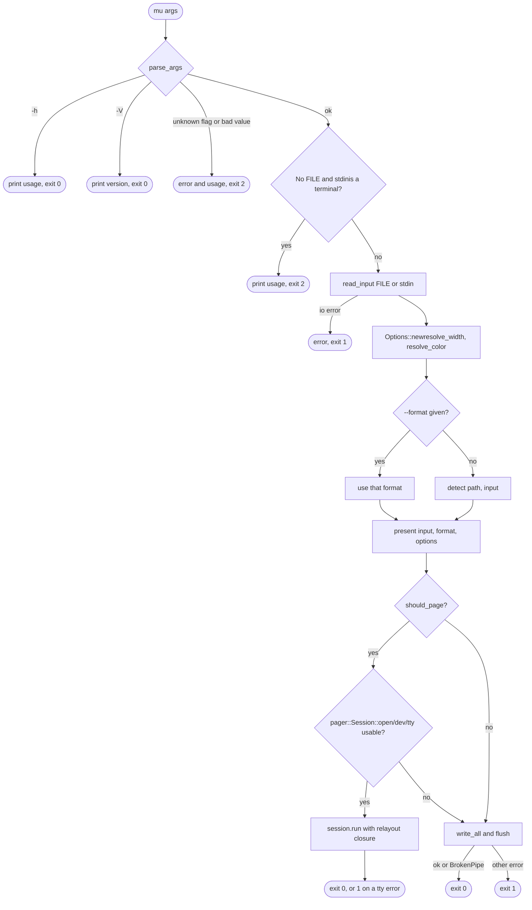
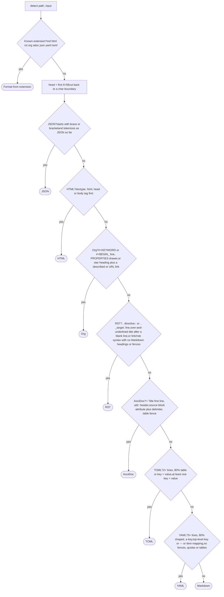
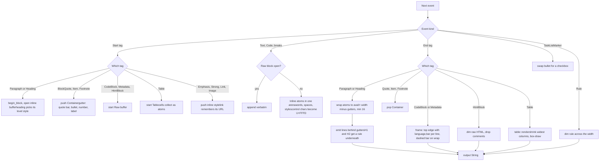
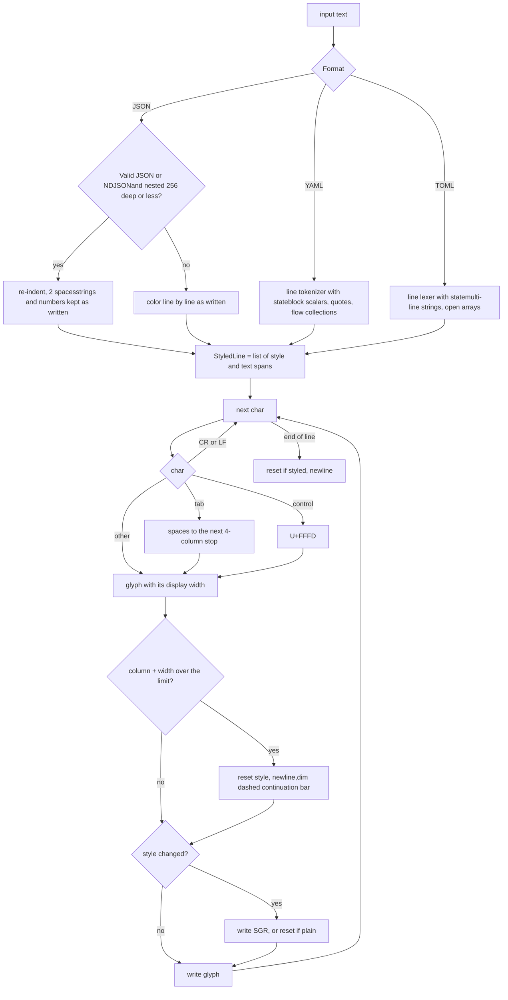
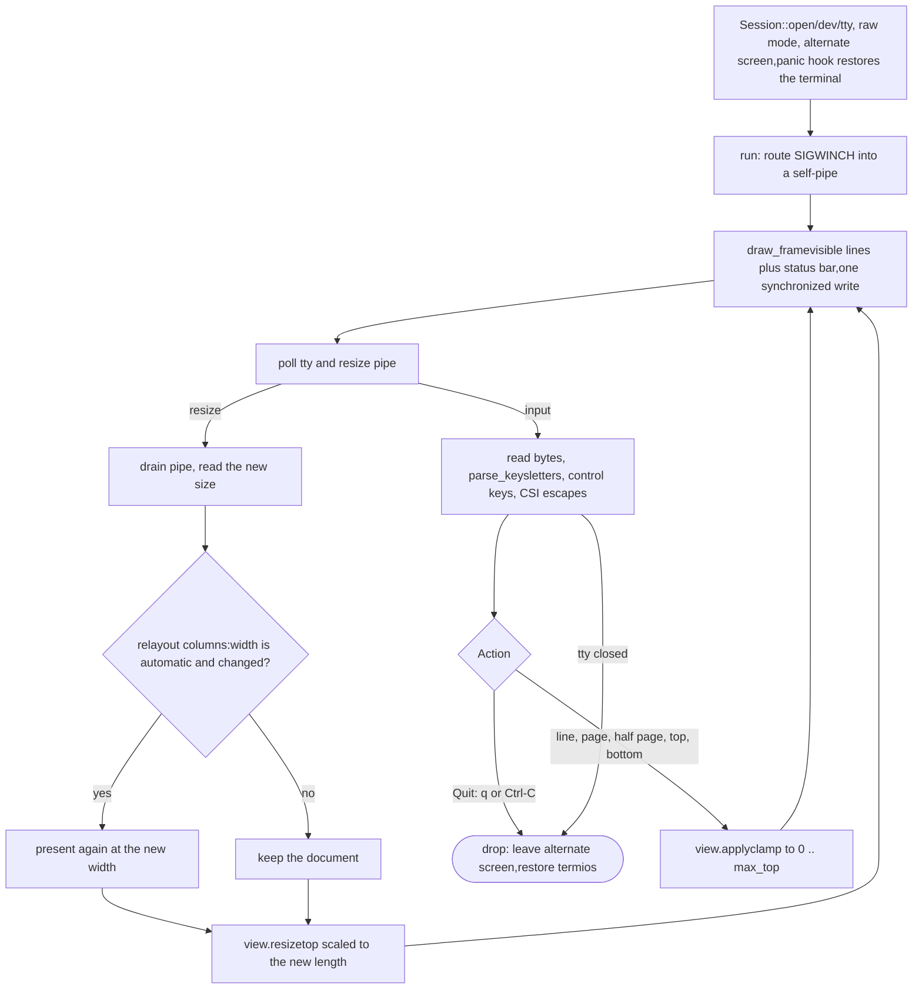
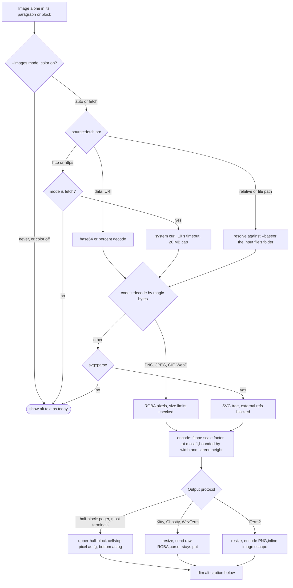

mu · markup/markdown utility · v0.2.0 + images in progress

# mu logic maps════════════════

How input becomes terminal output, traced through the real functions. Each map lists the code it follows, so you can open the file and walk it step by step. Diamonds are decisions; rounded ends are where the program exits.

[1 Overview](#overview) [2 CLI entry](#cli) [3 Format detection](#detect) [4 Document layout](#layout) [5 Data printing](#data) [6 Pager loop](#pager) [7 Images wip](#images)

## 1 · End to end

The two paths through mu. Documents become one event stream that a single layout engine lays out. Data formats become styled lines for a simpler printer. Both produce plain lines with their own SGR styling, which either print once or open in the pager.

- `src/main.rs:main` drives everything
- `src/format/mod.rs:present` picks the path
- `src/render.rs:render_events` documents
- `src/data/mod.rs:print` data

## 2 · CLI entry

What `main` does from arguments to exit code. A closed pipe such as `mu x.md | head` counts as success.

| Decision | Rule |
| --- | --- |
| resolve_width | `-w N` wins, at least 20. Otherwise the terminal width, clamped to 20–100. With no terminal, 80. The width is probed on stdout, then stderr, then stdin, so `mu x \| less -R` still sees the real width. |
| resolve_color | `always` / `never` as given. With `auto`, color is on when stdout is a terminal and `NO_COLOR` is unset or empty. |
| should_page | Never when stdout is not a terminal. `never` → no, `always` → yes. With `auto`, it pages only when the output has more lines than the screen minus one, like `less -F`. |

- `src/main.rs:parse_args`
- `src/main.rs:read_input`
- `src/main.rs:resolve_width` · `auto_width`
- `src/main.rs:should_page`
- `src/term.rs:size` TIOCGWINSZ

## 3 · Format detection

An extension decides immediately. Without one, as with stdin, `.txt` or no extension, the content is sniffed in a fixed order, most specific rule first. Every rule is strict, so uncertain input falls through to Markdown, which shows plain text correctly anyway.

- `src/format/mod.rs:detect` · `sniff`
- `src/data/json.rs:sniff`
- `src/format/html.rs:sniff`
- `src/format/org.rs:sniff` · `has_sniff_link`
- `src/format/rst.rs:sniff` · `has_markdown_structure`
- `src/format/asciidoc.rs:sniff`
- `src/data/toml.rs:sniff`
- `src/data/yaml.rs:sniff` · `is_prose_value`
- `tests/sniff.rs` pins every fixture to its format

## 4 · Document layout

One `Renderer` consumes events from any document format. Inline text collects as styled word atoms. When its block ends, the atoms are wrapped to the width left after container gutters, such as quote bars and list indents, and then written behind those gutters.

- `src/render.rs:Renderer::event` · `start` · `end`
- `src/render.rs:flush_inline` · `emit_lines` · `line_prefix`
- `src/render.rs:end_framed` · `verbatim_chunks`
- `src/inline.rs:Inline` · `wrap` · `push_clean`
- `src/table.rs:render`
- `src/format/{html,rst,org,asciidoc}.rs:events` feed this

## 5 · Data printing

Highlighters only classify text into styled spans. The shared printer owns everything that touches the terminal: tabs, control-character scrubbing, width and SGR. Every data format therefore keeps the same safety and layout guarantees as documents.

- `src/data/json.rs:highlight` · `sniff`
- `src/data/yaml.rs:highlight` · `State::line`
- `src/data/toml.rs:highlight`
- `src/data/mod.rs:print` · `Printer::glyph` · `end_line`
- `src/style.rs` STYLE_DATA\_\* theme

## 6 · Pager loop

The built-in pager reads keys from `/dev/tty`, which is why `curl … | mu` can page. A resize arrives through a self-pipe, so `poll` can never miss it. When the width is automatic, a resize re-renders at the new width and keeps the reader's place proportionally.

- `src/pager.rs:Session::open` · `run` · `drop`
- `src/pager.rs:ResizeSignal` · `on_resize`
- `src/pager.rs:wait_for_input` poll
- `src/pager.rs:parse_keys` · `key_action` · `escape_action`
- `src/pager.rs:View::apply` · `View::resize`
- `src/main.rs` relayout closure

## 7 · Images in progress · 0.3.0

This is the planned flow. The skeleton and entry points are committed, and the four parts are being built in parallel: sources, codecs, SVG and encoders. Renderer and CLI wiring come next. Any failure along the way falls back to the alt text that mu shows today.

- `src/image/mod.rs:load` · `draw` · `reserve`
- `src/image/source.rs:fetch` *(agent in progress)*
- `src/image/codec.rs:decode` · `encode_png` *(agent in progress)*
- `src/image/svg.rs:Svg` *(agent in progress)*
- `src/image/encode.rs:fit` · `half_blocks` · `kitty` · `iterm` *(agent in progress)*
- `src/image/base64.rs` done

Drawn from the mu source at commit 6697424 (v0.2.0 plus the image skeleton). The aspect math in map 7: the scale factor is the smaller of 1, max width in pixels over image width, and max height in pixels over image height. Cells are counted from that one factor, so width and height shrink together.