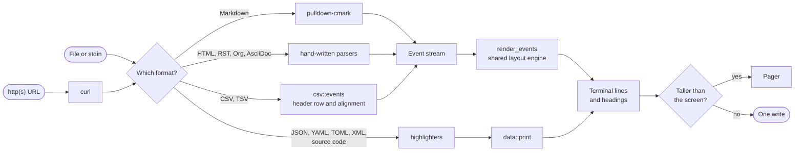

About 14,400 lines of Rust in one crate: a thin CLI around a library that turns text into styled terminal lines.

## Pipeline {#pipeline}

There are two paths through mu. **Documents** become one event stream that a single layout engine lays out. CSV and TSV **tables** join that path as table events. **Data** becomes styled lines for a simpler printer. Both paths produce plain lines that carry their own SGR styling, which then either print in one write or open in the pager.



Inside the document path the stages are: events → a per-block buffer of styled word atoms in one text arena → word wrap → container gutters (quote bars, list indents) prepended per line → one buffered write, or the pager. Styles are emitted lazily and every line closes its own style, so the pager can draw any window of lines on its own. The renderer also records each heading's level, plain text and first output line, which the pager's outline and `--toc` use.

CSV and TSV records become the same table events a Markdown table produces, so they share the table engine. Two settings differ: the width isn't capped at 100, and columns stop shrinking at 10 instead of 3.

The data path has highlighters that only classify text into styled spans. A shared printer owns everything that touches the terminal: tab expansion, control-character scrubbing, width and SGR. Every data format therefore keeps the same safety and layout guarantees as documents.

For the detailed flow of each stage, see the [logic maps](/wiki/logic-maps).

## Source layout {#source-layout}

```text
src/
  main.rs     CLI: args, input, width/color/paging decisions, --toc, single write
  fetch.rs    URL input: curl arguments, raw-file rewrites, response parsing
  pager/      built-in pager: raw mode, keys, scrolling, search, outline, sideways, resize, status bar
  term.rs     terminal size via TIOCGWINSZ
  lib.rs      public API: render, present, present_outlined, outline, detect, sniff, Format, Options
  outline.rs  heading list shared by --toc and the pager
  format/     Format enum, detection, dispatch; html, rst, org, asciidoc, man, csv → events; jupyter → Markdown
  data/       styled-line printer; json, yaml, toml, xml highlighters; verbatim code lines
  image/      sources, codecs, svg, fit and encoders (half block, Kitty, iTerm2)
  render.rs   event walker: blocks, containers, lists, code frames, headings
  inline.rs   styled word atoms, control-char scrubbing, word wrap
  table.rs    column fitting and box drawing
  style.rs    SGR styles and the color theme
```

| File | Lines | File | Lines |
|---|---|---|---|
| `format/asciidoc.rs` | 1398 | `data/xml.rs` | 625 |
| `pager/mod.rs` | 1189 | `main.rs` | 567 |
| `render.rs` | 1069 | `image/codec.rs` | 545 |
| `format/html.rs` | 1055 | `image/encode.rs` | 532 |
| `format/rst.rs` | 1037 | `data/yaml.rs` | 514 |
| `format/org.rs` | 892 | `fetch.rs` | 471 |

## Dependencies {#dependencies}

| Crate | Used for |
|---|---|
| `pulldown-cmark` 0.13 | Markdown parsing. Default features off, `simd` on: CommonMark plus GFM tables, strikethrough, task lists, footnotes, alerts |
| `unicode-width` | Display width of CJK and emoji |
| `libc` | The `TIOCGWINSZ` ioctl, `termios`, `select` and the resize self-pipe |
| `png`, `zune-jpeg`, `gif`, `image-webp` | Raster image decoding |
| `resvg` | SVG rendering, with default features off: no text, no system fonts |

Everything else is hand-written: the HTML, RST, Org and AsciiDoc parsers, the CSV and TSV reader, the JSON, YAML, TOML and XML tokenizers, image fitting and resampling, the half-block, Kitty and iTerm2 encoders, base64, and the pager with its search. There's no HTTP or TLS code; URLs go through the system `curl`.

The release profile uses `opt-level = 3`, fat LTO, one codegen unit and `strip`, giving a ~2.2 MB binary. It keeps `panic = "unwind"` on purpose, so a panic inside a third-party image decoder can be caught and shown as alt text.

## Library API {#library-api}

The binary is a thin CLI around the `mu` library crate, which exports:

```rust
pub use format::{Format, detect, present, present_outlined, sniff};
pub use image::{CellSize, ImageMode, ImageOptions, Protocol};
pub use outline::{outline, outline_entries};
pub use render::{Heading, Options, Rendered, render};
```

| Item | Purpose |
|---|---|
| `render(input, &Options) -> String` | Render Markdown |
| `present(input, Format, &Options) -> String` | Render any format |
| `present_outlined(input, Format, &Options) -> Rendered` | Render any format and keep its headings |
| `Rendered { text, headings }` | Rendered text plus its `Heading { level, text, line }` list; data formats have no headings |
| `outline(&[Heading], &Options) -> String` | The `--toc` text: headings indented by level, colored when `color` is on |
| `outline_entries(&[Heading], width) -> Vec<String>` | The same list as plain lines cut to a width |
| `detect(path: Option<&str>, input) -> Format` | Extension, then sniff, then Markdown |
| `sniff(input) -> Format` | Content sniffing alone |
| `Format` | Enum of every format, with `from_name`, `from_path`, `from_media_type`, `from_url_path`, `is_wide`, `name` |
| `Options { width, color, images }` | `Options::new(width, color)` builds text-only options with images off |
| `ImageOptions { mode, base, cell, protocol, max_rows }` | Image loading and drawing settings |

```rust
let options = mu::Options::new(80, true);
let format = mu::detect(Some("notes.org"), &text);
print!("{}", mu::present(&text, format, &options));
```

> [!NOTE]
> At 1.0, the CLI flags, exit codes and `mu::{render, present, Format, Options}` become stable. Until then, a breaking API change bumps the minor version.
