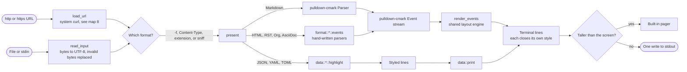
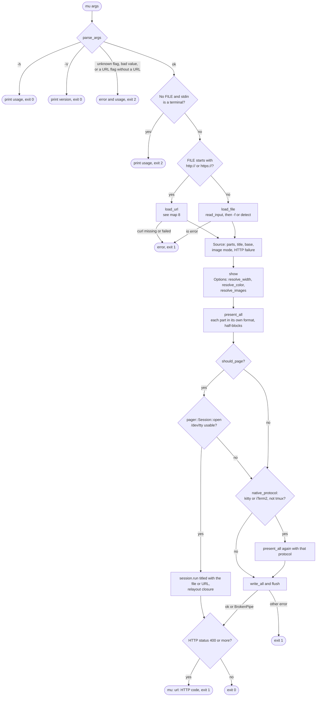
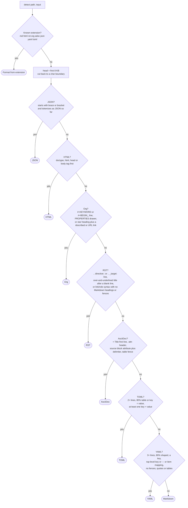
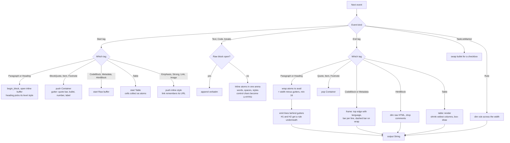
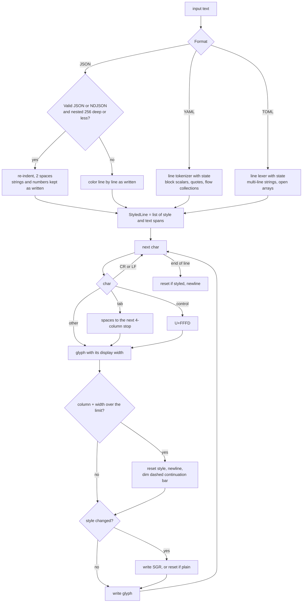
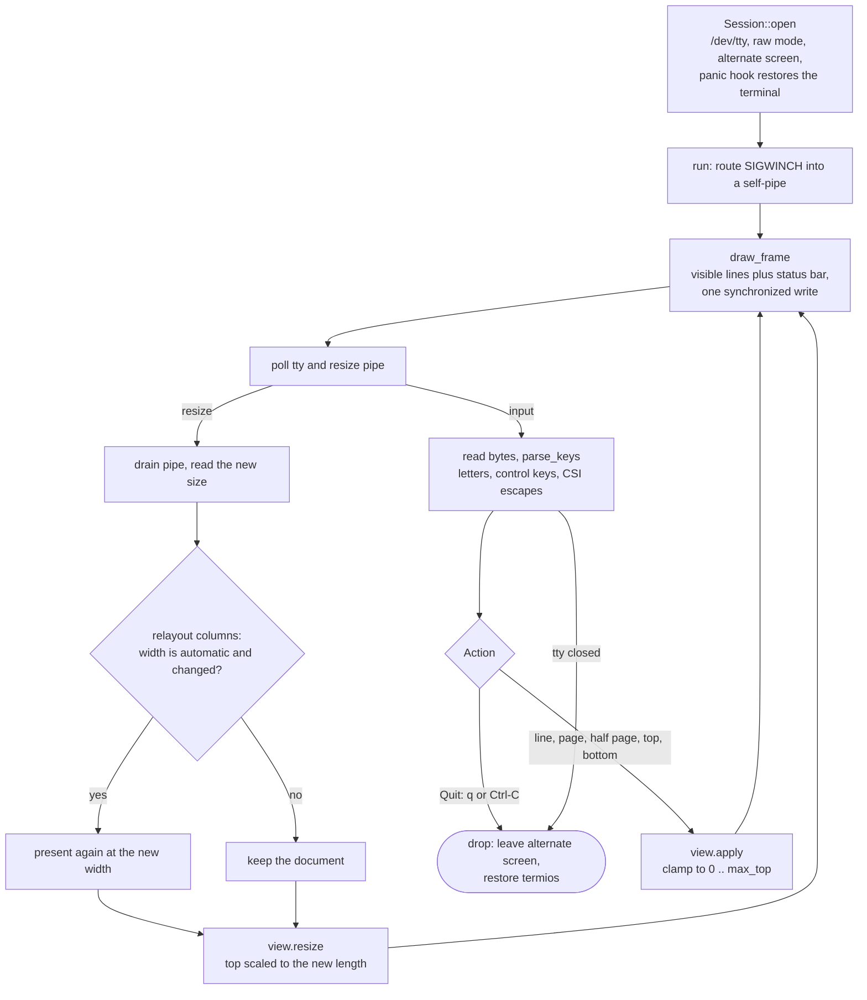
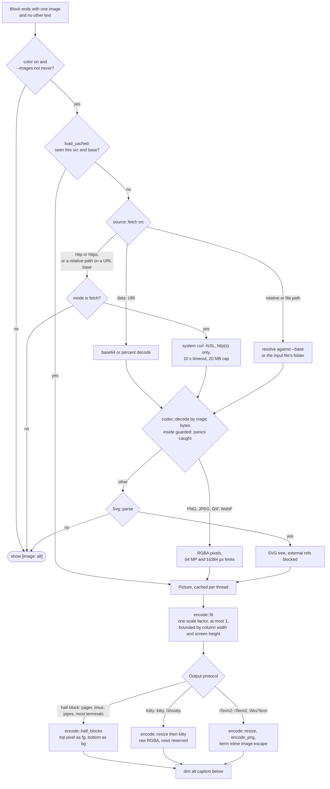
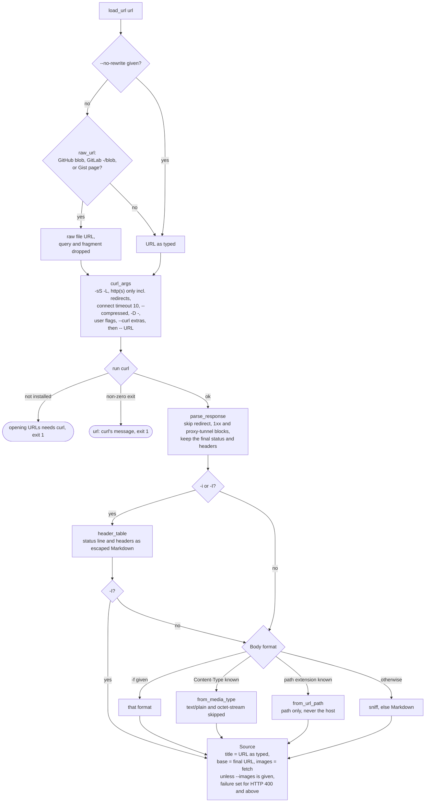

How input becomes terminal output, traced through the real functions. Each map lists the code it follows, so you can open the file and walk it step by step. Diamonds are decisions; rounded ends are where the program exits.

## 1 · End to end {#map-1}

The two paths through mu. Input is a file, stdin or a URL fetched with curl. Documents become one event stream that a single layout engine lays out. Data formats become styled lines for a simpler printer. Both produce plain lines with their own SGR styling, which either print once or open in the pager.

- `src/main.rs:main` drives everything
- `src/fetch.rs` URL input
- `src/format/mod.rs:present` picks the path
- `src/render.rs:render_events` documents
- `src/data/mod.rs:print` data

## 2 · CLI entry {#map-2}

What `main` does from arguments to exit code. Files and URLs both load into a `Source`, which `show` renders the same way. A closed pipe such as `mu x.md | head` counts as success.

| Decision | Rule |
| --- | --- |
| resolve_width | `-w N` wins, at least 20. Otherwise the terminal width, clamped to 20–100. With no terminal, 80. The width is probed on stdout, then stderr, then stdin, so `mu x \| less -R` still sees the real width. |
| resolve_color | `always` / `never` as given. With `auto`, color is on when stdout is a terminal and `NO_COLOR` is unset or empty. |
| resolve_images | Mode from `--images`, else `fetch` for a URL and `auto` for a file. Base from `--base`, else the file path or the final URL. Cell pixels from TIOCGWINSZ, else 8×16. At most the screen height minus 2 rows. |
| should_page | Never when stdout is not a terminal. `never` → no, `always` → yes. With `auto`, it pages only when the output has more lines than the screen minus one, like `less -F`. |

- `src/main.rs:parse_args`
- `src/main.rs:load_file` · `load_url` · `read_input`
- `src/main.rs:show` · `present_all` · `native_protocol`
- `src/main.rs:resolve_images`
- `src/main.rs:resolve_width` · `auto_width`
- `src/main.rs:should_page`
- `src/term.rs:size` TIOCGWINSZ

## 3 · Format detection {#map-3}

For a URL, the response `Content-Type` is tried first and then the URL path's extension (map 8). An extension decides immediately. Without one, as with stdin, `.txt` or no extension, the content is sniffed in a fixed order, most specific rule first. Every rule is strict, so uncertain input falls through to Markdown, which shows plain text correctly anyway.

- `src/format/mod.rs:detect` · `sniff`
- `src/data/json.rs:sniff`
- `src/format/html.rs:sniff`
- `src/format/org.rs:sniff` · `has_sniff_link`
- `src/format/rst.rs:sniff` · `has_markdown_structure`
- `src/format/asciidoc.rs:sniff`
- `src/data/toml.rs:sniff`
- `src/data/yaml.rs:sniff` · `is_prose_value`
- `tests/sniff.rs` pins every fixture to its format

## 4 · Document layout {#map-4}

One `Renderer` consumes events from any document format. Inline text collects as styled word atoms. When its block ends, the atoms are wrapped to the width left after container gutters, such as quote bars and list indents, and then written behind those gutters.

- `src/render.rs:Renderer::event` · `start` · `end`
- `src/render.rs:flush_inline` · `emit_lines` · `line_prefix`
- `src/render.rs:end_framed` · `verbatim_chunks`
- `src/inline.rs:Inline` · `wrap` · `push_clean`
- `src/table.rs:render`
- `src/format/{html,rst,org,asciidoc}.rs:events` feed this

## 5 · Data printing {#map-5}

Highlighters only classify text into styled spans. The shared printer owns everything that touches the terminal: tabs, control-character scrubbing, width and SGR. Every data format therefore keeps the same safety and layout guarantees as documents.

- `src/data/json.rs:highlight` · `sniff`
- `src/data/yaml.rs:highlight` · `State::line`
- `src/data/toml.rs:highlight`
- `src/data/mod.rs:print` · `Printer::glyph` · `end_line`
- `src/style.rs` STYLE_DATA_* theme

## 6 · Pager loop {#map-6}

The built-in pager reads keys from `/dev/tty`, which is why `curl … | mu` can page. A resize arrives through a self-pipe, so `poll` can never miss it. When the width is automatic, a resize re-renders at the new width and keeps the reader's place proportionally.

- `src/pager.rs:Session::open` · `run` · `drop`
- `src/pager.rs:ResizeSignal` · `on_resize`
- `src/pager.rs:wait_for_input` poll
- `src/pager.rs:parse_keys` · `key_action` · `escape_action`
- `src/pager.rs:View::apply` · `View::resize`
- `src/main.rs` relayout closure

## 7 · Images {#map-7}

How an image in a document becomes a picture. Only an image standing alone in its paragraph or block is drawn; inside running text it stays `[image: alt]`. Every failure, including a decoder panic, falls back to that alt text, never to an error.

- `src/render.rs:draw_standalone_image`
- `src/image/mod.rs:load_cached` · `load` · `guarded`
- `src/image/mod.rs:draw_guarded` · `draw` · `reserve`
- `src/image/source.rs:fetch` · `join_url` · `remote`
- `src/image/codec.rs:decode` · `encode_png`
- `src/image/svg.rs:Svg::parse` · `rasterize`
- `src/image/encode.rs:fit` · `half_blocks` · `kitty` · `iterm`
- `src/main.rs:native_protocol` picks the protocol

## 8 · URL fetch {#map-8}

What `mu <url>` does before the shared rendering takes over. mu has no HTTP or TLS code; it runs the system `curl` without a shell, with the URL as one argument after `--`. Response headers come back on stdout ahead of the body, and the final URL comes back on stderr.

| Flag | Sent to curl as |
| --- | --- |
| -H -X -u -k | the same flag. `-H` repeats. |
| -d, --data | `--data`, repeatable. |
| -A | `-A`, default `mu/VERSION`. |
| -I | `-I -o /dev/null`, so the headers come only through `-D -` and are not repeated. |
| --timeout | `--max-time`. |
| --curl ARG | ARG verbatim, before `--`. |
| -i, --no-rewrite | nothing: handled by mu. |

- `src/main.rs:load_url`
- `src/fetch.rs:is_url` · `raw_url`
- `src/fetch.rs:curl_args` · `fetch`
- `src/fetch.rs:parse_response` · `split_block` · `is_interim`
- `src/fetch.rs:header_table` · `escape_markdown`
- `src/format/mod.rs:from_media_type` · `from_url_path`
- `tests/url.rs` runs against a local server

Drawn from the mu source at v0.4.0. The aspect math in map 7: the scale factor is the smaller of 1, max width in pixels over image width, and max height in pixels over image height. Cells are counted from that one factor, so width and height shrink together.

Source: `docs/muLogicMaps.md` in the mu repository. Diagrams render with Mermaid from a CDN; offline, their source text is shown instead.
